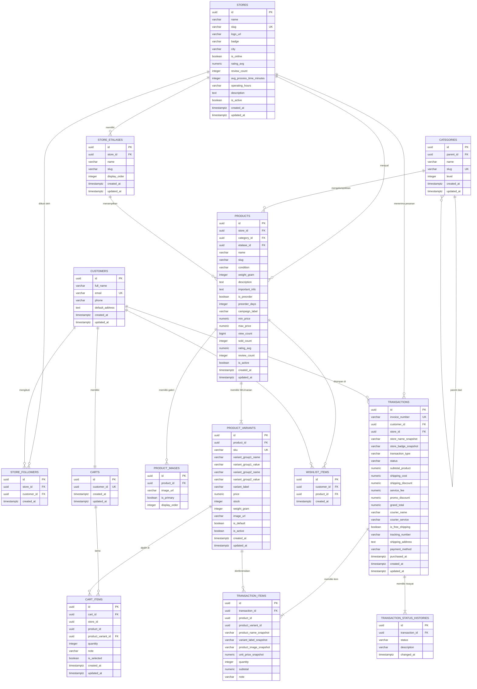
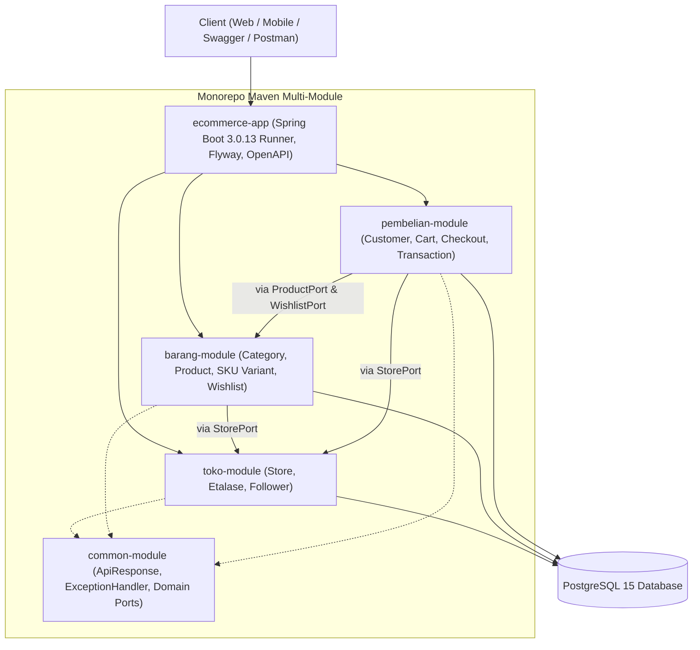
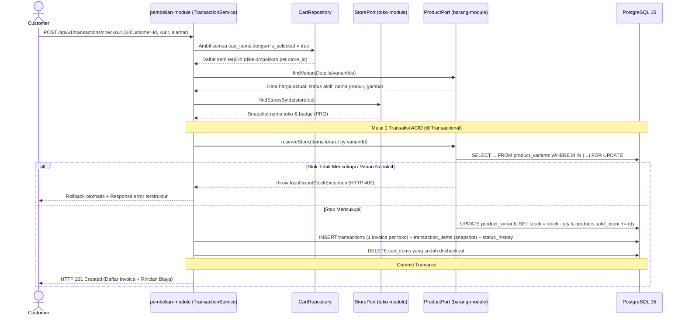

# Bagian 2 — Design Modules (Sistem E-Commerce)

Dokumen ini merancang **Desain Database** dan **Desain Arsitektur Modul** untuk aplikasi e-commerce seperti Tokopedia berdasarkan 5 skenario & referensi UI di folder `imgs/`, disertai alasan teknis di balik setiap keputusan desain.

---

## 1. Analisis Kebutuhan dari 5 Referensi UI (`imgs/`)

| No | Referensi UI | Komponen & Fitur yang Diekstrak | Implikasi ke Desain Data & Bisnis |
|---|---|---|---|
| 1 | `imgs/catalog.png` | Profil toko (`iStorebdg`, logo, badge `PRO`, status `Online`, kota `Kota Bandung`, rating `5.0`, kecepatan proses `± 3 jam`, jam buka `Buka 24 jam`), aksi `Following`, tab `Beranda/Produk/Ulasan`, sidebar `Etalase Toko (13)` (3 filter bawaan: `Semua Produk`, `Produk Terjual`, `Preorder` + 10 etalase kustom), dropdown `Urutkan: Terbaru`, kartu produk (thumbnail, badge `PreOrder`/`Apple Campaign`, judul, harga, `rating \| Terjual N`). | Membutuhkan tabel `stores`, `store_etalases`, dan `store_followers`. `Etalase` adalah pengelompokan **milik toko**, berbeda dari `Category` global. Produk memerlukan atribut `is_preorder`, `campaign_label`, `sold_count`, `rating_avg`, `min_price`, dan `created_at` untuk filter & sorting cepat. |
| 2 | `imgs/item.png` | Breadcrumb kategori multi-level (`Home > Komputer & Laptop > Laptop > Laptop Consumer`), galeri multi-foto, judul dinamis + varian terpilih, counter `411 orang melihat barang ini`, harga per SKU (`Rp36.499.000`), matriks varian 2 level (`Pilih varian`: Inter/iBox M2 Pro/Max × `Pilih ukuran`: 16/512GB..32/1TB, dengan kombinasi tertentu nonaktif/tidak tersedia), tab `Detail` & `Info Penting`, atribut (`Kondisi: Baru`, `Berat Satuan: 3 kg`, `Kategori`, `Etalase`, deskripsi), panel pembelian (`Stok: 999`, stepper qty, `Tambah Catatan`, `Subtotal`, `+ Keranjang`, `Beli Langsung`, `Wishlist`). | Membutuhkan tabel `categories` (*self-referencing tree* untuk breadcrumb), `products`, `product_images` (`1-to-N`), dan `product_variants` (level **SKU** yang memegang `price`, `stock`, `is_active`, serta pasangan nilai varian agar kombinasi seperti `Inter M2 Pro` + `32/1TB` dapat ditandai tidak tersedia). |
| 3 | `imgs/cart.png` | Checkbox `Pilih Semua` & tombol `Hapus` massal, pengelompokan item **per toko** (`PRO iStorebdg - Kota Bandung`), produk **tanpa varian** (`Apple 20W USB-C Power Adapter`, `Rp429.000`) dan produk **dengan varian** (`Apple MacBook Pro 2023... - Inter M2 Pro, 16/512GB Silver`, `Rp36.499.000`), aksi `Tulis Catatan`, `Pindahkan ke Wishlist`, hapus, stepper qty, panel `Ringkasan belanja` (`Makin hemat pakai promo`, `Total Harga (2 barang): Rp36.928.000`, CTA `Beli (2)`). | Setiap produk memiliki minimal 1 baris `product_variants` (*default SKU* untuk produk tanpa varian) sehingga `cart_items` selalu merujuk ke `product_variant_id` secara konsisten tanpa duplikasi logika stok. `cart_items` menyimpan `is_selected` (checkout parsial), `quantity`, `note`, dan `store_id` (grouping cepat per toko). |
| 4 | `imgs/list-transaction.png` | Search `Cari transaksimu di sini`, filter jenis (`Semua Produk`), date range (`Pilih Tanggal Transaksi`), chip status (`Semua`, `Berlangsung`, `Berhasil`, `Tidak Berhasil`, `E-tiket & E-voucher Aktif`, `Reset Filter`), shortcut `Menunggu Pembayaran`, kartu transaksi (`Belanja`, `10 Feb 2023`, status `Selesai`, `INV/20230210/MPL/3038611559`, toko `PRO emilab`, item `1 barang x Rp429.000`, `Total Belanja Rp 431.300`, `Lihat Detail Transaksi`, `Beli Lagi`). | **Temuan kritis**: Harga item `Rp429.000` dengan pengiriman `BEBAS ONGKIR`, namun `Total Belanja` = **`Rp 431.300`** (selisih `+Rp 2.300`). Tabel `transactions` wajib memisahkan komponen finansial: `subtotal_product`, `shipping_cost`, `shipping_discount`, `service_fee`, `promo_discount`, dan `grand_total`. |
| 5 | `imgs/detail-transaction.png` | Status `Selesai` + ekspansi `Lihat Detail v` (riwayat status), `No. Invoice`, `Tanggal Pembelian` (`10 Februari 2023, 11:56 WIB`), `Detail Produk` (`PRO emilab`, snapshot judul + varian `... - MH01`, `1 x Rp429.000`, `Total Harga Rp429.000`, `Beli Lagi`), `Info Pengiriman` (`Kurir: AnterAja - Reguler`, badge `BEBAS ONGKIR`). | Membutuhkan tabel `transaction_items` yang menyimpan **snapshot** nama produk, label varian, gambar, dan harga satuan saat checkout agar invoice historis tetap akurat walau katalog berubah, serta tabel `transaction_status_histories` untuk timeline pelacakan status. |

---

## 2. Desain Database (PostgreSQL 15)

### 2.1 Entity Relationship Diagram (ERD)

### 2.2 Penjelasan Detail Setiap Tabel, Constraint & Relasi

#### Domain Toko (`toko-module`)
1. **`stores`**: Menyimpan profil master toko.
   - **PK**: `id (UUID)`. **Unique**: `slug`.
   - **Check**: `badge IN ('REGULAR', 'POWER_MERCHANT', 'POWER_MERCHANT_PRO', 'OFFICIAL_STORE')`, `rating_avg BETWEEN 0 AND 5`.
   - Menyimpan atribut UI `catalog.png`: `city`, `is_online`, `rating_avg`, `avg_process_time_minutes` (mis. `180` → ditampilkan `± 3 jam`), `operating_hours` (`Buka 24 jam`).
2. **`store_etalases`**: Koleksi etalase kustom milik toko (`iPhone dan Aksesoris`, `MacBook dan Aksesoris`, dll.).
   - **PK**: `id (UUID)`. **FK**: `store_id -> stores(id)`. **Unique**: `(store_id, slug)`.
3. **`store_followers`**: Relasi *many-to-many* customer yang mengikuti toko (tombol `Following`).
   - **PK**: `id (UUID)`. **FK**: `store_id -> stores(id)`, `customer_id -> customers(id)`. **Unique**: `(store_id, customer_id)`.

#### Domain Barang (`barang-module`)
4. **`categories`**: Hierarki kategori global berbasis *Adjacency List* (`parent_id`) untuk breadcrumb `Komputer & Laptop > Laptop > Laptop Consumer`.
   - **PK**: `id (UUID)`. **FK**: `parent_id -> categories(id)` (nullable untuk kategori root). **Unique**: `slug`.
5. **`products`**: Informasi induk barang yang tampil di katalog dan halaman detail.
   - **PK**: `id (UUID)`. **FK**: `store_id -> stores(id)`, `category_id -> categories(id)`, `etalase_id -> store_etalases(id)` (nullable).
   - **Check**: `condition IN ('NEW', 'USED')`, `weight_gram > 0`, `min_price >= 0`, `max_price >= min_price`.
   - **Denormalisasi terukur**: Kolom `min_price`, `max_price`, `sold_count`, dan `view_count` disimpan di `products` agar sorting katalog (`Terbaru`, `Termurah`, `Terlaris`) berjalan cepat tanpa `GROUP BY` berat ke seluruh SKU setiap request.
6. **`product_images`**: Galeri gambar produk (gambar utama + thumbnail).
   - **PK**: `id (UUID)`. **FK**: `product_id -> products(id) ON DELETE CASCADE`.
7. **`product_variants`**: Representasi SKU aktual yang dapat dibeli.
   - **PK**: `id (UUID)`. **FK**: `product_id -> products(id) ON DELETE CASCADE`. **Unique**: `sku`.
   - **Check**: `price >= 0`, `stock >= 0`.
   - Mendukung produk bervarian 1–2 dimensi (`variant_group1_name/value`, `variant_group2_name/value`, `variant_label`) maupun produk non-varian (1 baris default dengan `is_default = true`, `variant_label = NULL`).
   - Mengapa stok & harga diletakkan di `product_variants`? Karena pada `item.png`, harga dan ketersediaan berbeda antar kombinasi (`Inter M2 Pro 16/512GB` tersedia dengan `Rp36.499.000`, sedangkan `32/1TB` nonaktif untuk chip tersebut).
8. **`wishlist_items`**: Produk favorit customer (dari tombol `Wishlist` di `item.png` & `Pindahkan ke Wishlist` di `cart.png`).
   - **PK**: `id (UUID)`. **Unique**: `(customer_id, product_id)`.

#### Domain Pembelian (`pembelian-module`)
9. **`customers`**: Data identitas pembeli dan alamat pengiriman default.
   - **PK**: `id (UUID)`. **Unique**: `email`.
10. **`carts`**: Keranjang aktif per customer (`1-to-1` dengan `customers`).
    - **PK**: `id (UUID)`. **Unique FK**: `customer_id -> customers(id)`.
11. **`cart_items`**: Item yang dimasukkan ke keranjang.
    - **PK**: `id (UUID)`. **FK**: `cart_id -> carts(id) ON DELETE CASCADE`, `product_variant_id -> product_variants(id)`. **Unique**: `(cart_id, product_variant_id)` (mencegah duplikasi baris untuk SKU yang sama—penambahan ulang otomatis mengakumulasi `quantity`).
    - **Check**: `quantity > 0`.
    - Kolom `is_selected` mendukung checkout selektif (`Pilih Semua` / centang sebagian), `note` mendukung `Tulis Catatan`, dan `store_id` mempercepat pengelompokan per toko (`cart.png`).
12. **`transactions`**: Header pesanan/invoice (1 invoice per toko saat checkout).
    - **PK**: `id (UUID)`. **Unique**: `invoice_number` (pola `INV/YYYYMMDD/MPL/<10-digit>`).
    - **FK**: `customer_id -> customers(id)`, `store_id -> stores(id)`.
    - **Check**: `status IN ('MENUNGGU_PEMBAYARAN', 'DIBAYAR', 'DIPROSES', 'DIKIRIM', 'TIBA_DI_TUJUAN', 'SELESAI', 'DIBATALKAN')`, `transaction_type IN ('BELANJA', 'ETIKET_VOUCHER')`, `grand_total >= 0`.
    - Menyimpan **breakdown finansial lengkap** (`subtotal_product`, `shipping_cost`, `shipping_discount`, `service_fee`, `promo_discount`, `grand_total`) dengan tipe `NUMERIC(19,2)` (bukan `FLOAT`/`DOUBLE`, guna menghindari *rounding error* uang) dan info logistik (`courier_name`, `courier_service`, `is_free_shipping`, `tracking_number`, `shipping_address`).
13. **`transaction_items`**: Detail item yang dibeli pada suatu invoice.
    - **PK**: `id (UUID)`. **FK**: `transaction_id -> transactions(id) ON DELETE CASCADE`.
    - Menggunakan pola **Immutable Snapshot** (`product_name_snapshot`, `variant_label_snapshot`, `product_image_snapshot`, `unit_price_snapshot`) agar laporan transaksi & invoice historis tidak berubah saat penjual mengedit harga/judul produk di masa depan.
14. **`transaction_status_histories`**: Log audit perpindahan status pesanan untuk fitur `Lihat Detail v` pada `detail-transaction.png`.
    - **PK**: `id (UUID)`. **FK**: `transaction_id -> transactions(id) ON DELETE CASCADE`.

### 2.3 Strategi Indexing PostgreSQL 15
| Tabel | Index | Tujuan Query yang Dioptimalkan |
|---|---|---|
| `stores` | `idx_stores_city_active (city, is_active)` | Filter toko aktif per kota |
| `store_etalases` | `idx_etalases_store_order (store_id, display_order)` | Render sidebar `Etalase Toko` terurut cepat |
| `categories` | `idx_categories_parent (parent_id)` | Traversing pohon kategori & subkategori |
| `products` | `idx_products_store_etalase_active (store_id, etalase_id, is_active)` | Filter katalog per toko & etalase (`catalog.png`) |
| `products` | `idx_products_store_created (store_id, created_at DESC)` | Sorting default `Urutkan: Terbaru` |
| `products` | `idx_products_store_sold (store_id, sold_count DESC)` | Filter `Produk Terjual` & sorting terlaris |
| `products` | `idx_products_category (category_id)` | Pencarian katalog per kategori global |
| `product_variants` | `idx_variants_product_active (product_id, is_active)` | Ambil daftar SKU aktif saat buka detail produk (`item.png`) |
| `cart_items` | `idx_cart_items_cart_store (cart_id, store_id)` | Grouping item keranjang per toko (`cart.png`) |
| `transactions` | `idx_tx_customer_purchased (customer_id, purchased_at DESC)` | Daftar transaksi terbaru per pembeli (`list-transaction.png`) |
| `transactions` | `idx_tx_customer_status_date (customer_id, status, purchased_at DESC)` | Filter chip `Status` + `Pilih Tanggal Transaksi` |
| `transactions` | `idx_tx_store_status (store_id, status)` | Dashboard pesanan masuk per toko |
| `transaction_items` | `idx_tx_items_tx (transaction_id)` | Fetch detail produk di `detail-transaction.png` |
| `transaction_status_histories` | `idx_tx_history_tx_time (transaction_id, changed_at DESC)` | Timeline riwayat status pesanan |

---

## 3. Desain Arsitektur Sistem & Pembagian Modul

### 3.1 Perbandingan Opsi Arsitektur: Monolith vs Modular Monolith vs Microservices

| Kriteria | Traditional Monolith | **Modular Monolith (Dipilih)** | Microservices |
|---|---|---|---|
| **Struktur Kode** | 1 modul besar, rawan *tight coupling* | **Monorepo multi-module Maven** dengan batas kontrak (`Port` interface) tegas antar domain | Banyak service terpisah + komunikasi jaringan (REST/gRPC/Kafka) |
| **Konsistensi Transaksi (Stok & Checkout)** | ACID langsung | **ACID langsung (`@Transactional` + `PESSIMISTIC_WRITE`)**, bebas *overselling* tanpa kerumitan Saga | Butuh Saga Pattern, Outbox, dan *Eventual Consistency* |
| **Kompleksitas Operasional** | Rendah | **Rendah** (1 JAR, 1 DB PostgreSQL 15, mudah dijalankan reviewer) | Tinggi (API Gateway, Service Discovery, Distributed Tracing, banyak DB) |
| **Kesiapan Scale ke Microservices** | Sangat sulit dipecah | **Tinggi**: tinggal mengganti adapter `StorePort`/`ProductPort` lokal menjadi HTTP/OpenFeign client & memecah schema DB | Sudah terpecah sejak awal |

### 3.2 Keputusan Desain: **Modular Monolith Monorepo (Hexagonal / Port-Adapter Boundaries)**

**Mengapa memilih Modular Monolith Monorepo untuk sistem Toko, Barang, dan Pembelian ini?**
1. **Integritas Data Transaksi & Pencegahan *Overselling***: Proses checkout melibatkan pembacaan profil toko, validasi & pengurangan stok pada `product_variants` (multi-item), pencatatan `transactions` + `transaction_items`, pembaruan `sold_count`, dan pembersihan `cart_items`. Di Modular Monolith, seluruh rangkaian ini dieksekusi dalam **satu transaksi ACID PostgreSQL** dengan *pessimistic row locking* (`SELECT ... FOR UPDATE`), sehingga 100% atomik dan jauh lebih reliabel dibanding transaksi terdistribusi prematur.
2. **Isolasi Domain Tetap Terjaga (*Microservices-Ready*)**: Dalam monorepo ini, `toko-module`, `barang-module`, dan `pembelian-module` **tidak saling mengimpor `Repository` atau `Entity` satu sama lain**. Komunikasi lintas modul dilakukan murni melalui kontrak interface di `common-module` (`StorePort`, `ProductPort`, `WishlistPort`). Jika di masa depan trafik katalog melonjak dan `barang-module` perlu diekstrak menjadi `barang-service` terpisah, kode inti `pembelian-module` tidak perlu ditulis ulang—cukup mengganti implementasi adapter port dari panggilan lokal menjadi REST/Feign/gRPC client.
3. **Prinsip *"Monolith First"* & Efisiensi Tim**: Mengikuti praktik terbaik industri (Martin Fowler — *MonolithFirst*), memulai dari Modular Monolith pada fase awal menghindari beban infrastruktur berlebih sambil menjaga *developer velocity*, kemudahan pengujian end-to-end, dan kemudahan deployment.

### 3.3 Diagram Arsitektur Modul Monorepo

### 3.4 Alur Komunikasi Antar Modul (Sequence Diagram: Checkout & Pengurangan Stok)

### 3.5 Evolusi Menuju Microservices (Roadmap Skalabilitas)
Ketika trafik dan ukuran tim berkembang melampaui kapasitas satu deployment:
1. **Pemisahan Database**: Pisahkan tabel per domain menjadi 3 database terpisah (`db_toko`, `db_barang`, `db_pembelian`), hilangkan FK fisik lintas domain (karena `pembelian-module` sudah tidak memiliki JPA `@ManyToOne` ke entitas `toko`/`barang`!).
2. **Ekstraksi Service**: Bungkus masing-masing modul (`toko-service`, `barang-service`, `pembelian-service`) dengan `@SpringBootApplication` sendiri di belakang **Spring Cloud Gateway**.
3. **Swap Port Adapter**: Ganti `StorePortAdapter` & `ProductPortAdapter` lokal dengan *OpenFeign / WebClient* + *Resilience4j Circuit Breaker*.
4. **Distributed Transaction**: Terapkan **Orchestration Saga + Transactional Outbox** (PostgreSQL + Debezium/Kafka) untuk reservasi stok dan kompensasi saat pembayaran kedaluwarsa/dibatalkan.
